# SOC Automation: Wazuh + Shuffle + TheHive + Cortex

An automated incident-response pipeline. Authentication-failure alerts raised by **Wazuh** are sent to **Shuffle** (SOAR), turned into **TheHive** alerts and cases, and enriched with IP reputation data from **Cortex** (AbuseIPDB analyzer), with no manual steps between detection and an analyst-ready case.

> University project (FAST NUCES, *Network and CyberSec-II*), built together with Qalander Aziz.

## Architecture

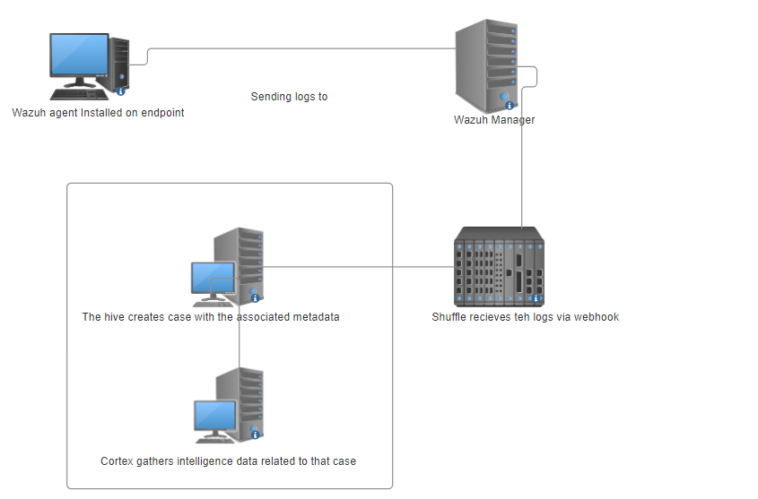

| VM | Role | Software |
|----|------|----------|
| 1 | Monitored endpoint | Wazuh agent (Ubuntu 22.04) |
| 2 | Detection / SIEM | Wazuh manager |
| 3 | Orchestration | Shuffle |
| 4 | Case management + enrichment | TheHive 4.1.24, Cortex 3.1.8 |

## How it works

1. The **Wazuh agent** sends endpoint logs to the **Wazuh manager** (port 1514/TCP).
2. The manager forwards only alerts for **rule 2501** (user authentication failure) to a **Shuffle webhook**.
3. Shuffle creates an **alert in TheHive** from the Wazuh payload.
4. Shuffle adds the **source IP as an observable** to that alert.
5. Shuffle calls the TheHive API (`/api/alert/<id>/createCase`) to **promote the alert to a case**.
6. Shuffle fetches the observable ID and runs the **AbuseIPDB analyzer** through Cortex.
7. The analyst opens the case and sees the **reputation report** attached to the IP.

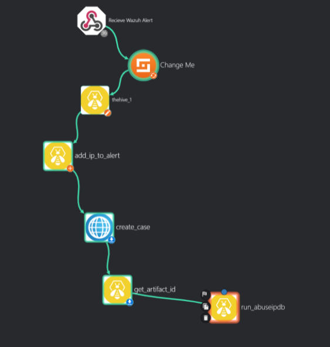

## Setup walkthrough

### 1. Wazuh agent and manager
Point the agent at the manager in `/var/ossec/etc/ossec.conf`, then confirm it registered with `manage_agents -l`.

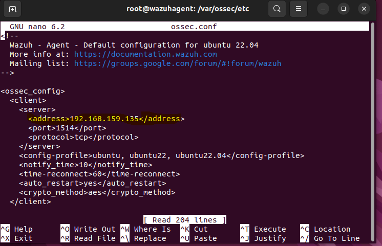
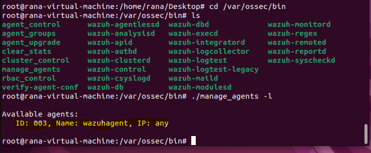

### 2. Wazuh → Shuffle integration
Add the Shuffle integration files from the official Shuffle repository to the manager and configure the integration block (rule `2501`, JSON alert format). The webhook URL is redacted in the screenshot; see [`configs/ossec.conf.example`](configs/ossec.conf.example).

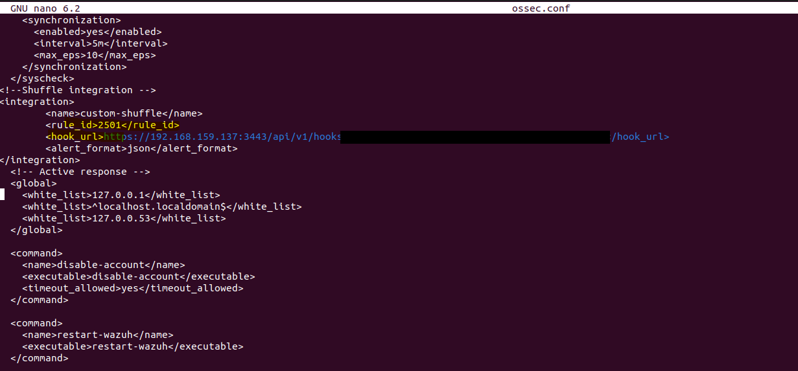
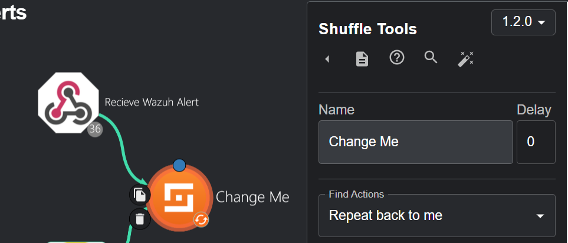

### 3. Shuffle → TheHive
Create the alert, attach the IP observable, then create the case with an HTTP `curl` node.

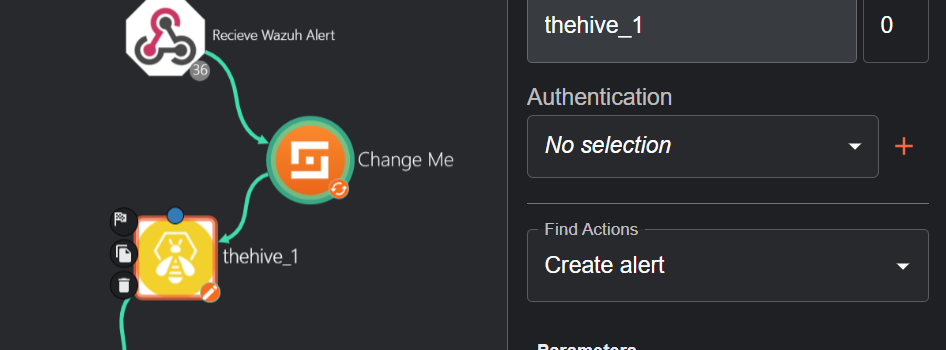
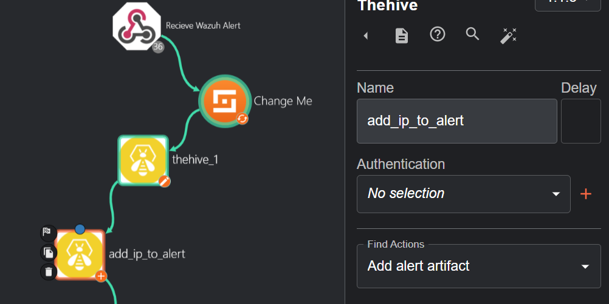
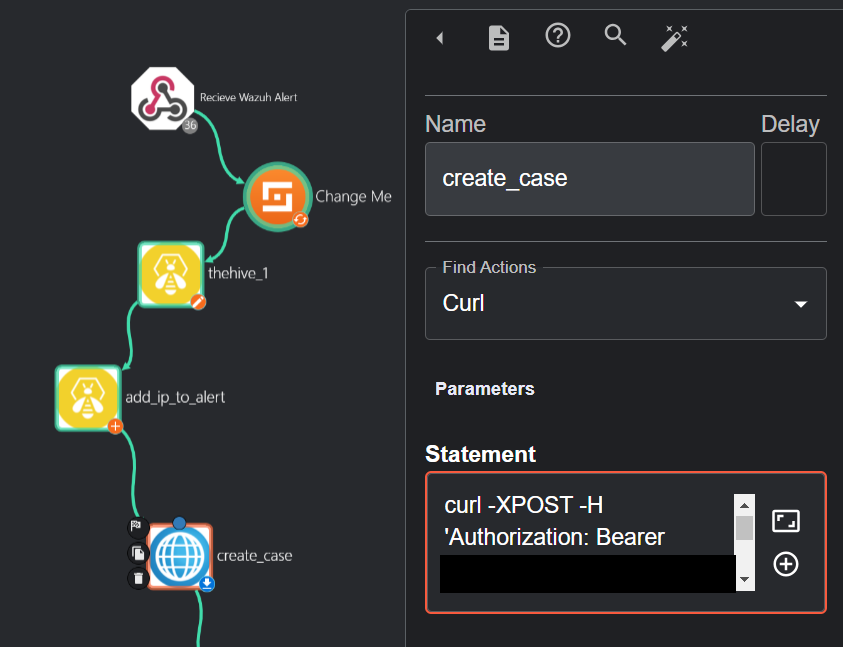

### 4. TheHive results
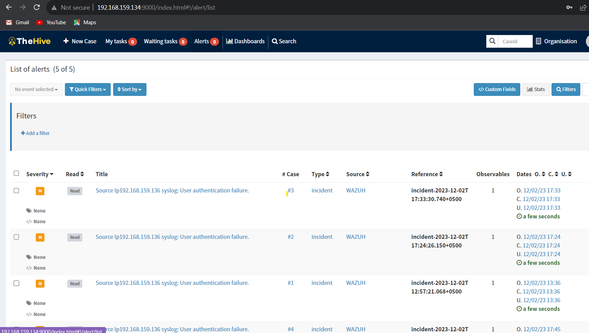
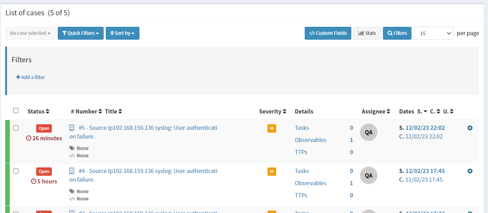
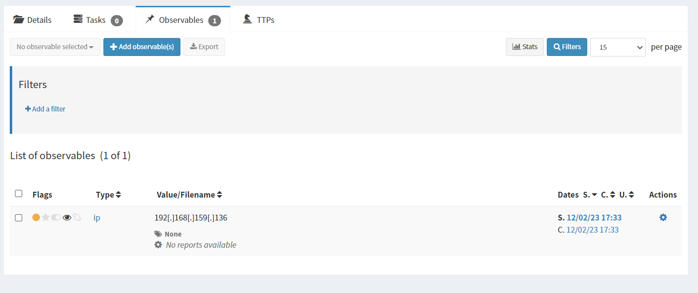

### 5. Cortex and analyzers
Cortex runs on the same VM as TheHive. The analyzers repository is cloned and referenced in `/etc/cortex/application.conf`; AbuseIPDB is enabled with an API key.

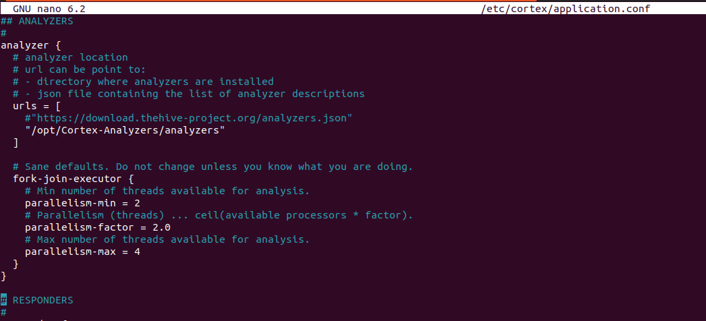
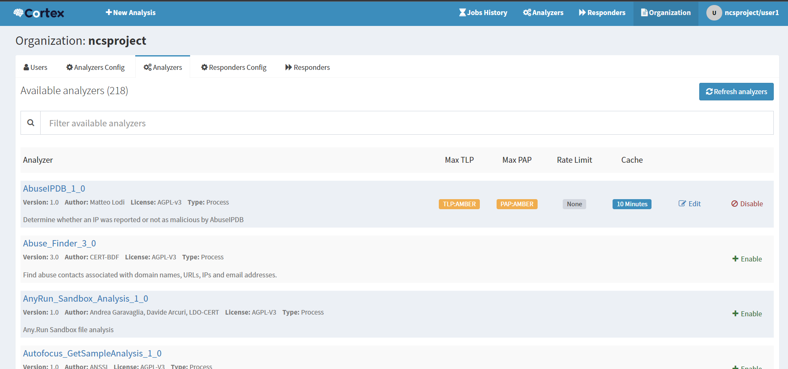

### 6. Connect TheHive to Cortex
The Cortex connector is configured in TheHive's `application.conf` (see [`configs/thehive-application.conf.example`](configs/thehive-application.conf.example)). Status shows **OK** after restart.

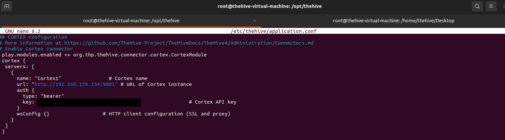
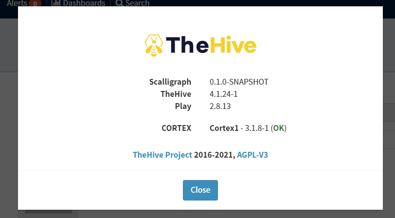

### 7. Run the analyzer from the workflow
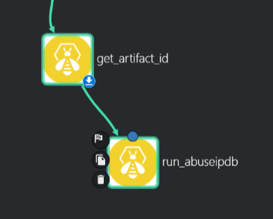
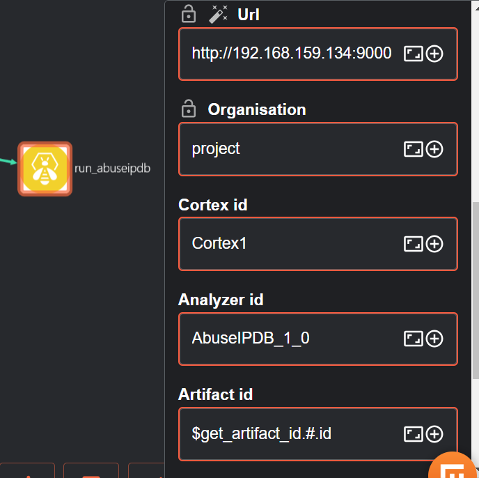

## Result

The enriched observable inside the case:

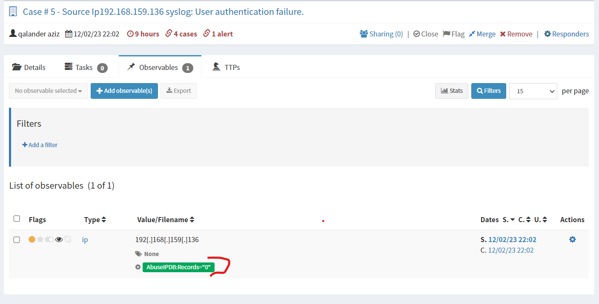

## Limitations and next steps

- **The test IP is a private address** (`192.168.159.136`, RFC 1918). AbuseIPDB only tracks public IPs, so `Records = 0` here means "not applicable", not "safe". Against real external attackers the analyzer would return meaningful scores.
- Only **rule 2501** is forwarded. Next: add more rules (SSH brute force, privilege escalation, FIM alerts).
- Only one analyzer is used. Next: add **VirusTotal** and **OTX**, and combine verdicts.
- Next: set case severity from the enrichment score, auto-close benign cases, and notify the analyst (email/Slack).
- Next: replace "Change Me" with a meaningful node name and export the workflow JSON.

## Security note

API keys and the Shuffle webhook ID were removed from screenshots, and configuration examples use placeholders. Lab keys were rotated after publishing.

## Tools

Wazuh · Shuffle · TheHive 4 · Cortex 3 · AbuseIPDB · Ubuntu 22.04 · VMware

## Authors

Mustabsir Munir Toor and Qalander Aziz
